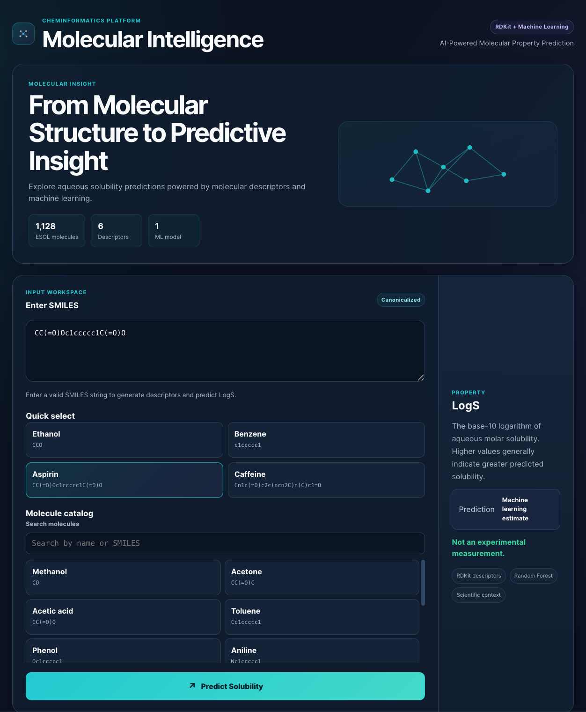
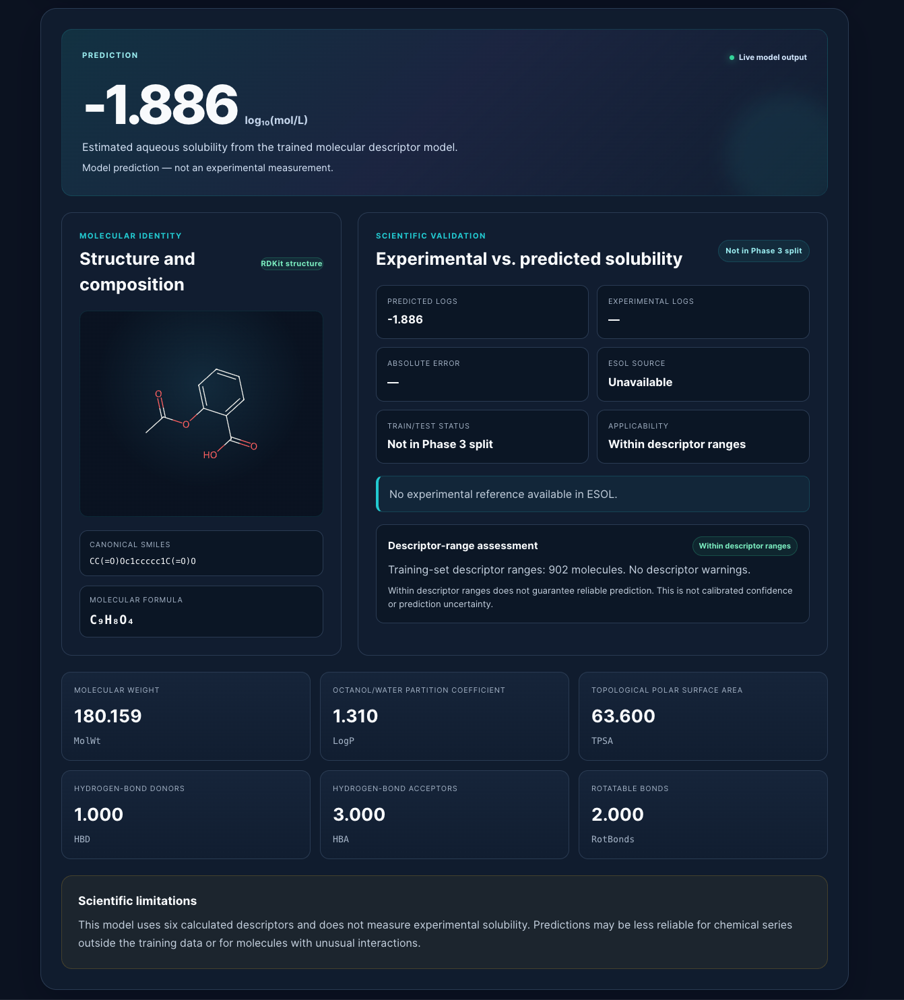
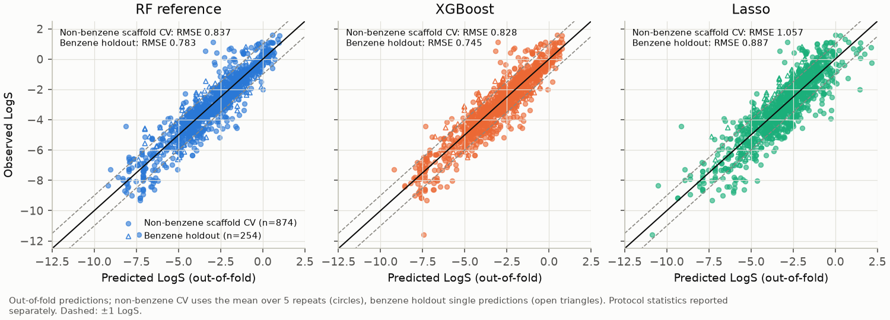
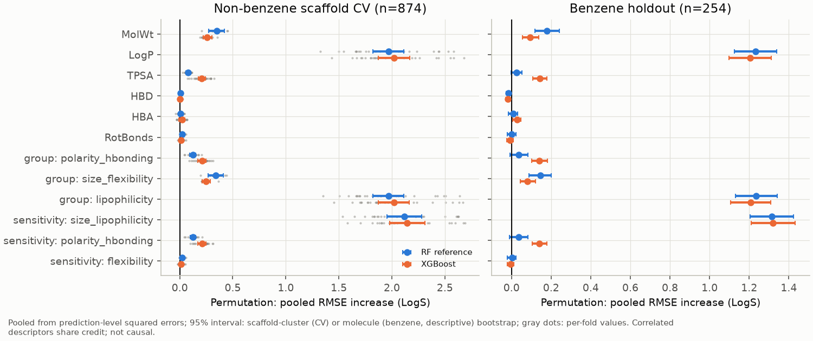
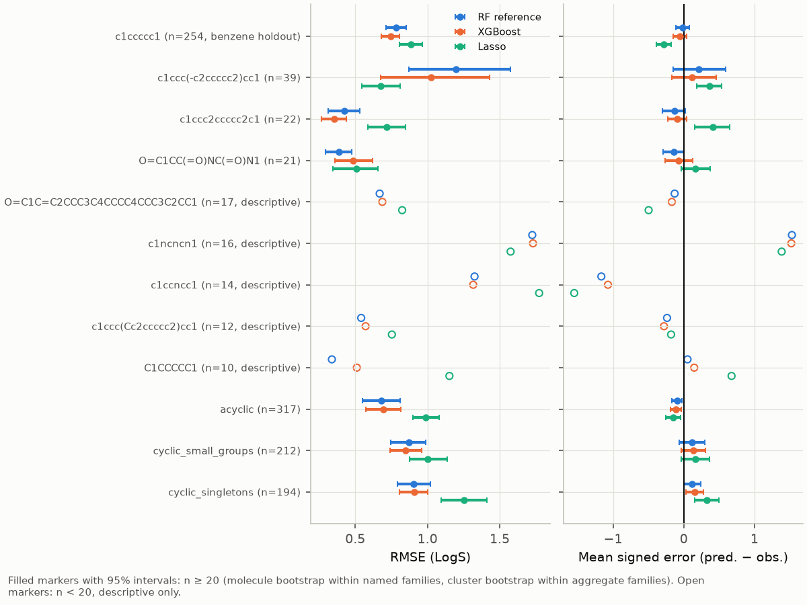
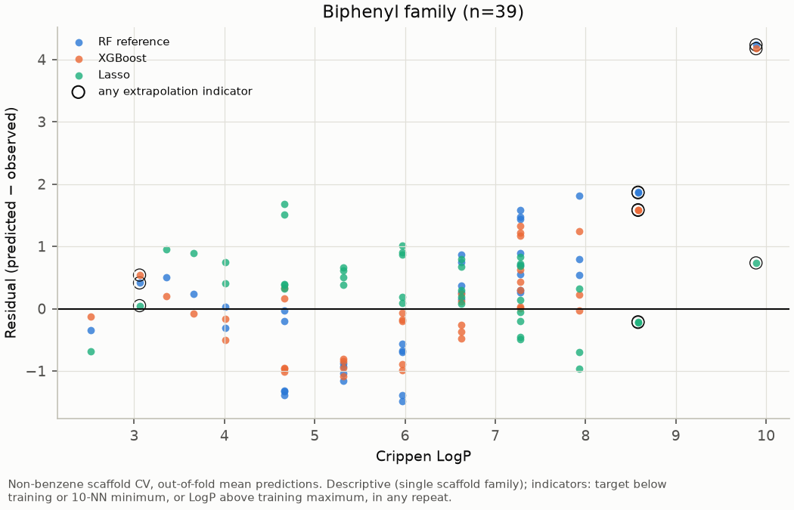
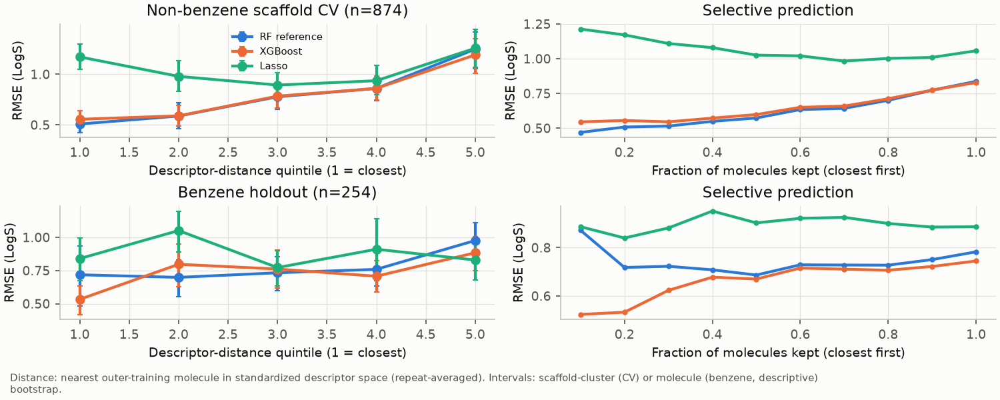

# Molecular Property Predictor

**Cheminformatics · RDKit · scikit-learn · XGBoost · FastAPI · React**

Molecular Property Predictor predicts aqueous solubility (LogS, log₁₀ mol/L) from molecular structure. It has two parts:

1. **A deployed application.** A FastAPI backend and React frontend turn a SMILES string into six RDKit descriptors and a Random Forest prediction. The response adds an experimental comparison when the molecule is in ESOL, plus descriptive applicability-domain information.
2. **A validation and diagnostics study.** A prespecified experimental design asks how well descriptor-based models generalize to **chemical scaffolds they have not seen**, and then characterizes where and why they fail.

All results come from a single public dataset, ESOL, and are evaluated by internal cross-validation only. **There is no external validation.**

## Project summary

| | |
|---|---|
| Data | ESOL (Delaney), 1,128 molecules; target: measured LogS |
| Features | 6 RDKit descriptors: MolWt, LogP, TPSA, HBD, HBA, RotBonds |
| Deployed model | Random Forest (200 trees), trained once on a Phase 3 random split |
| Experimental models | Mean baseline, Lasso, linear regression, Random Forest (production configuration and tuned), XGBoost |
| Validation | Random split → single scaffold split → grouped nested cross-validation → scaffold-held-out cross-validation with a separate benzene holdout, scaffold-cluster bootstrap and a prespecified practical-equivalence margin |
| Diagnostics | Calibration, residuals, permutation / drop-column / TreeSHAP / ALE, scaffold-family bias, similarity and descriptor-space distance, representation floor, exploratory interval coverage |
| Engineering | 145 backend tests and 12 frontend tests; configuration-driven, checksum-verified experiments |

## Deployed model vs experimental models

| | Deployed model (served by the app) | Experimental models (Phases 6B–6E) |
|---|---|---|
| What | `RandomForestRegressor(n_estimators=200, random_state=42)` | Lasso, linear regression, XGBoost, tuned Random Forest, and the production configuration retrained per fold |
| Training data | Phase 3 random split: 902 training molecules | Refitted inside each cross-validation fold |
| Reported performance | Held-out random split (226 molecules): RMSE 0.835, R² 0.853 | Scaffold-grouped cross-validation (below) |
| Status | `models/solubility_model.joblib`, used by `src/api.py` | Offline analysis only. **None has been deployed or has replaced the Phase 3 model.** |

Phase 6 evaluated the *same configuration* as the deployed model under scaffold-grouped validation. It did not retrain, modify or replace the deployed model.

## Application





For a submitted SMILES string, the app returns:
- the predicted LogS;
- an RDKit structure drawing, molecular formula and the six descriptors;
- the ESOL experimental value when the canonical structure is in ESOL (conflicting duplicates are reported as ambiguous, not resolved);
- whether the molecule was in the Phase 3 training or test split;
- a descriptor-range check against the training data.

The prediction is a model estimate, not a measurement. The range check is descriptive and is **not a confidence measure**: in Phase 6E it flagged only 15 of 874 cross-validation molecules.

### How the application works

```text
SMILES ──► FastAPI  POST /api/predict
             ├─ RDKit: parse, canonicalize, molecular formula, SVG drawing
             ├─ six descriptors, in the saved feature order (models/feature_columns.joblib)
             ├─ Random Forest prediction (models/solubility_model.joblib)
             ├─ ESOL lookup by canonical SMILES (stereochemistry preserved)
             └─ descriptor-range check against the Phase 3 training set
          ◄── JSON ──► React/Vite dashboard (prediction, structure, descriptors, validation card)
```

The API loads the saved model read-only and never retrains it. `GET /api/health` reports whether the model is loaded. The frontend reads its backend address from `VITE_API_BASE_URL` (default `http://127.0.0.1:8003`).

## Scientific motivation

Aqueous solubility affects formulation, bioavailability and environmental fate. Descriptor-based models can estimate it cheaply. However, random train/test splits put close analogues on both sides of the split and overstate how well a model handles **new chemistry**. This project therefore treats *validation design* as the main object of study: grouping by molecular identity and by Bemis–Murcko scaffold, tuning only inside training folds, and reporting uncertainty with stated assumptions.

## Dataset

**ESOL (Delaney)**, as distributed by DeepChem. The download is pinned to DeepChem commit [`108af21`](https://github.com/deepchem/deepchem/blob/108af2176a5f876c2df1df922baadb02d647c826/datasets/delaney-processed.csv) and checked by checksum (see [Reproducibility](docs/REPRODUCIBILITY.md)).

- **Size:** 1,128 molecules and 1,117 unique canonical structures. 11 structures appear twice; 6 of those pairs have differing values. The largest difference (1.03 LogS) is mannitol vs sorbitol, stereoisomers whose SMILES omit stereochemistry.
- **Target:** `measured log solubility in mols per litre`.
- **Excluded column:** ESOL's own predicted solubility is never used as a feature. It is used only as an in-sample comparator in Phase 6E.

## Molecular descriptors

| Descriptor | RDKit function | Represents |
|---|---|---|
| MolWt | `Descriptors.MolWt` | Molecular size |
| LogP | `Descriptors.MolLogP` (Crippen, *calculated*) | Lipophilicity |
| TPSA | `Descriptors.TPSA` (N and O contributions by default) | Polar surface area |
| HBD / HBA | `Descriptors.NumHDonors` / `Descriptors.NumHAcceptors` | Hydrogen-bonding capacity |
| RotBonds | `Descriptors.NumRotatableBonds` | Flexibility |

These six descriptors cannot represent crystal-lattice energy or melting point, ionization and pH, stereochemistry, or substitution pattern (positional isomers often share identical descriptors).

## Validation design

| Phase | Design | Document |
|---|---|---|
| 3–4 | Single random 80/20 split; single Murcko scaffold split | [Phase 3](docs/PHASE3_TEACHBACK.md), [Phase 4](docs/PHASE4_TEACHBACK.md) |
| 6A | Data-quality and leakage audit; reproduction of baselines | [6A report](docs/PHASE6A_REPORT.md) |
| 6B | Lasso and XGBoost added outside the production workflow | [6B report](docs/PHASE6B_REPORT.md) |
| 6C | Nested 5×5 cross-validation, 3 repeats, grouped by identity and by scaffold | [6C report](docs/PHASE6C_REPORT.md) |
| 6D | Prespecified experimental design: non-benzene scaffold CV (5 folds × 5 repeats; benzene always in training) and a **separate** benzene holdout; molecule-weighted tuning; scaffold-cluster bootstrap; δ = 0.05 LogS equivalence margin; duplicate sensitivity analysis | [6D plan](docs/PHASE6D_PLAN.md), [6D report](docs/PHASE6D_REPORT.md) |
| 6E | Prespecified diagnostics of the Phase 6D models | [6E plan](docs/PHASE6E_PLAN.md), [6E report](docs/PHASE6E_REPORT.md) |

## Key results

RMSE in LogS units. All cross-validation numbers are out-of-fold.

| Evaluation | RF (production config) | XGBoost | Lasso | Source |
|---|---|---|---|---|
| Random split, single (Phase 3) | 0.835 | — | — | Phase 3 |
| Scaffold split, single (Phase 4) | 0.880 | — | — | Phase 4 |
| Scaffold-grouped nested CV, 15 folds (Phase 6C) | 0.821 | 0.802 | 1.025 | Phase 6C |
| **Non-benzene scaffold CV**, 874 molecules (Phase 6D, primary) | **0.837** | **0.828** | **1.057** | Phase 6D |
| Benzene holdout, 254 molecules (Phase 6D, separate protocol) | 0.783 | 0.745 | 0.887 | Phase 6D |

**Primary comparison (Phase 6D).** RMSE(RF) − RMSE(XGBoost) = **0.009 LogS** (95% scaffold-cluster bootstrap interval −0.016 to 0.035). Under the prespecified rule this is *practically equivalent at δ = 0.05 LogS*.
- **Conditions:** this holds only for that margin, and only if the bootstrap's assumptions hold (independent, exchangeable scaffold groups; uncertainty conditional on the fitted models). A margin of 0.03 would make the result inconclusive.
- **Robustness:** the label held under the duplicate-sensitivity variants, and Δ stayed between 0.008 and 0.011 across model seeds.
- **Lasso:** about 0.22 LogS worse than the RF (interval 0.131 to 0.305).

## Findings



**Figure 1.** Out-of-fold predictions for non-benzene scaffold CV (874 molecules, mean over 5 repeats; circles) and the benzene holdout (254 molecules; triangles). RMSE is reported separately for each protocol: RF 0.837 / 0.783, XGBoost 0.828 / 0.745, Lasso 1.057 / 0.887. Dashed lines mark ±1 LogS.



**Figure 2.** Pooled permutation importance, computed from prediction-level squared errors with 95% bootstrap intervals; gray dots are per-fold values.
- **LogP ranks first in every fold** (RMSE increase about 2.0 LogS when shuffled).
- **Its information is largely shared with other descriptors.** Dropping LogP and refitting costs only 0.34–0.36 LogS, while dropping MolWt and LogP together costs about 1.2.
- **Correlated descriptors share credit**, so importance describes what the models rely on, not chemical causation.



**Figure 3.** RMSE and mean signed error by scaffold family; intervals are shown only for n ≥ 20.
- **Triazines** (n = 16, mostly s-triazine herbicides) are over-predicted by about 1.4–1.5 LogS.
- **Pyridines** (n = 14) are under-predicted by about 1.1–1.6 LogS by every model.
- Both families are **descriptive observations**, not established effects. A missing melting-point (crystal-lattice) term for the triazines is a hypothesis that ESOL cannot test.



**Figure 4.** Biphenyls (n = 39, descriptive): tree-model residuals grow with LogP.
- **Beyond the training range** (4 molecules, e.g. decachlorobiphenyl, LogS −11.6): RMSE is 2.50 (RF) and 2.39 (XGBoost) vs 0.40 (Lasso). Tree models cannot predict outside the targets they were trained on; a linear model extrapolates.
- **Within the training range** (the other 35): RMSE is 0.94 / 0.72 / 0.70.



**Figure 5.** Error vs distance to the nearest training molecule in standardized descriptor space.
- **Random Forest RMSE rises across distance quintiles,** from 0.51 to 1.25 (non-benzene CV).
- **Keeping only the closest 10% of molecules** gives RMSE 0.47, against 0.84 for all.
- **Distance ranks reliability for the tree models but not for Lasso.**

The [Phase 6E report](docs/PHASE6E_REPORT.md) also covers calibration and shrinkage, extreme errors, acyclic molecules and close analogues, the representation floor, and exploratory interval coverage. All 19 figures are in [`docs/images/phase6e/`](docs/images/phase6e/).

## Limitations

- **Single dataset.** ESOL combines heterogeneous literature measurements with unrecorded temperature, pH and polymorph, and no per-measurement uncertainty. It is dominated by pesticides and environmental chemicals. No external validation was performed.
- **Representation.** 304 molecules share an identical six-descriptor vector with another molecule. This sets a **dataset-specific floor of 0.144 LogS RMSE** for any model on these descriptors. It is not a universal limit on solubility error, and not a measure of measurement noise. LogP is itself a calculated estimate.
- **Generalization.** Assessed by scaffold-grouped cross-validation within ESOL only. Acyclic molecules (28% of the data) are grouped only by exact identity, and 12.3% of them have a training neighbour with an identical fingerprint, so their accuracy reflects close analogues in training.
- **Chemical-family biases.** Triazines, pyridines and highly chlorinated aromatics are poorly predicted. The family diagnostics are descriptive.
- **Uncertainty.** The bootstrap intervals rest on stated assumptions. The per-prediction interval diagnostics in Phase 6E are exploratory, **not calibrated prediction intervals**: their coverage drops to about 0.3–0.4 at nominal 90% for triazines and pyridines. The application shows no uncertainty.
- **Interpretation.** Importance, TreeSHAP and ALE describe these models on ESOL. They are not chemical mechanisms.

## What this project does not claim

- **No external validation.** All performance numbers come from held-out data *within* ESOL.
- **No calibrated prediction intervals**, and the application reports no per-prediction uncertainty.
- **No causal chemical interpretation.** Feature importance and effect curves describe model behaviour.
- **No production-grade deployment.** The application runs locally for demonstration; it has no authentication, monitoring or scaling.
- **No transfer to other properties or materials.** ESOL solubility results are not evidence about other molecular or materials properties.

## Testing

| Suite | Command | Count | Covers |
|---|---|---|---|
| Backend | `python -m pytest -q` | 145 tests in 8 modules | Descriptors, training, evaluation, API, experimental models, cross-validation splitters and leakage checks, scaffold protocols and bootstrap, diagnostics and the refit check |
| Frontend | `cd frontend && npm test` | 12 tests | Prediction flow, example and catalog selection, formula formatting, structure rendering, experimental-reference display, loading and error states |
| Build | `cd frontend && npm run build` | — | Production bundle |

Two backend tests need the original, Git-ignored experiment artifacts, so on a fresh clone both are skipped with an explanatory message (details in [docs/REPRODUCIBILITY.md](docs/REPRODUCIBILITY.md#5-tests)).

## Quick start

```bash
git clone https://github.com/Vdevannah/molecular-property-predictor.git
cd molecular-property-predictor
python3.12 -m venv .venv && source .venv/bin/activate
python -m pip install -r requirements.txt      # macOS: brew install libomp (needed by XGBoost)

mkdir -p data
curl -L https://raw.githubusercontent.com/deepchem/deepchem/108af2176a5f876c2df1df922baadb02d647c826/datasets/delaney-processed.csv -o data/esol.csv
python src/descriptors.py      # data/esol_descriptors.csv
python src/train_model.py      # models/solubility_model.joblib (the deployed model)
python -m pytest -q            # fresh clone: 143 passed, 2 skipped (see docs/REPRODUCIBILITY.md)

uvicorn src.api:app --host 127.0.0.1 --port 8003           # backend
cd frontend && npm ci && npm run dev -- --host 127.0.0.1 --port 5175   # frontend (Node ^20.19 or >=22.12)
```

Checksum verification, the experiment commands for Phases 4–6E, expected values and exactly what can and cannot be replayed are in **[docs/REPRODUCIBILITY.md](docs/REPRODUCIBILITY.md)**.

## Reproducibility at a glance

| Level | What it means here |
|---|---|
| **Auditable** | Reports, figures and a tracked evidence bundle ([`reports/evidence/`](reports/evidence/): out-of-fold predictions, fold assignments and metrics; byte-for-byte copies) can be inspected without running code. [`reports/ARTIFACT_MANIFEST.json`](reports/ARTIFACT_MANIFEST.json) lists SHA-256 checksums for every untracked artifact. |
| **Numerically reproducible** | In a tested fresh clone, the data, descriptors and deployed model were byte-identical. Phases 3–6C reproduced the reported numbers (byte-identical, or differing only in the last floating-point digit or in timing fields). Phases 6D and 6E were each run twice in the original environment, with identical results apart from timing fields. |
| **Exact replay** | The Phase 6D and 6E configurations verify checksums of their original inputs, including Phase 6C files that contain timings and, for 6E, the canonical Phase 6D run directory. **A fresh clone cannot run Phase 6D or 6E unchanged** without those original artifacts. |

## Repository structure

```text
molecular-property-predictor/
├── src/
│   ├── descriptors.py          # SMILES → six RDKit descriptors
│   ├── train_model.py          # Phase 3: deployed Random Forest
│   ├── evaluate_model.py       # Phase 4: random and scaffold split evaluation
│   ├── api.py                  # FastAPI application
│   ├── model_experiments.py    # Phase 6B: experimental models
│   ├── cross_validation.py     # Phase 6C: grouped nested cross-validation
│   ├── scaffold_evaluation.py  # Phase 6D: scaffold generalization
│   └── model_diagnostics.py    # Phase 6E: diagnostics and figures
├── tests/                      # 8 pytest modules (145 tests)
├── frontend/                   # React + Vite application (12 tests)
├── configs/                    # Prespecified Phase 6D and 6E configurations
├── reports/                    # Tracked JSON results, evidence bundle, artifact manifest
├── docs/                       # Phase reports, plans, reproducibility guide, figures
├── data/, models/, results/    # Local, regenerated, Git-ignored (see manifest)
├── requirements.txt
└── LICENSE                     # MIT
```

## Technology

Python 3.12 · RDKit 2026.3.6 · pandas · NumPy · scikit-learn 1.9.1 · XGBoost 3.4.1 · SciPy · Matplotlib · FastAPI · Uvicorn · React 19 · Vite 7 · pytest · Vitest

## Author

**Vijayarajan Devannah, Ph.D.** · Organic Chemistry · Cheminformatics · Data Science

[GitHub repository](https://github.com/Vdevannah/molecular-property-predictor) · Licensed under the [MIT License](LICENSE)
