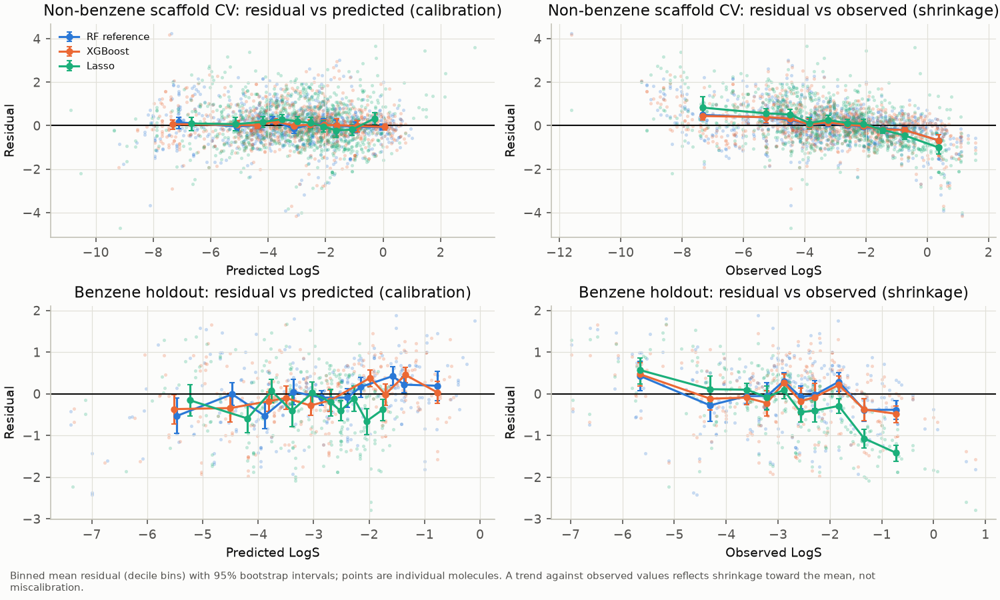
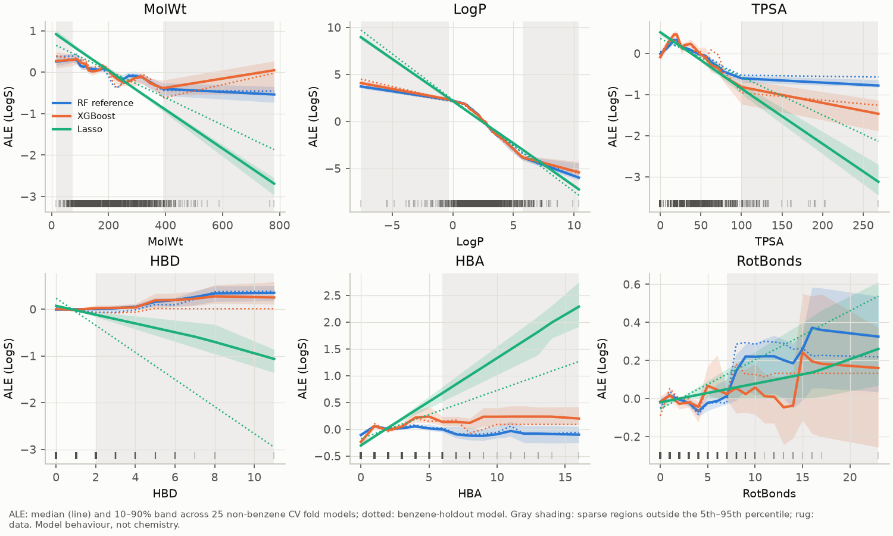
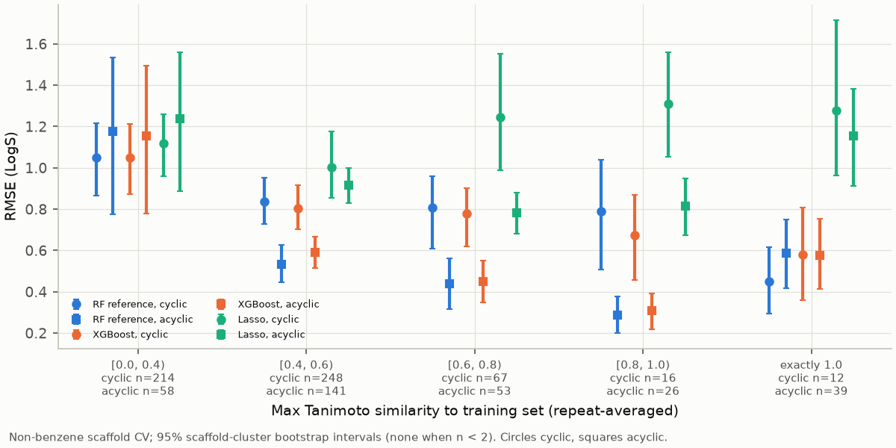
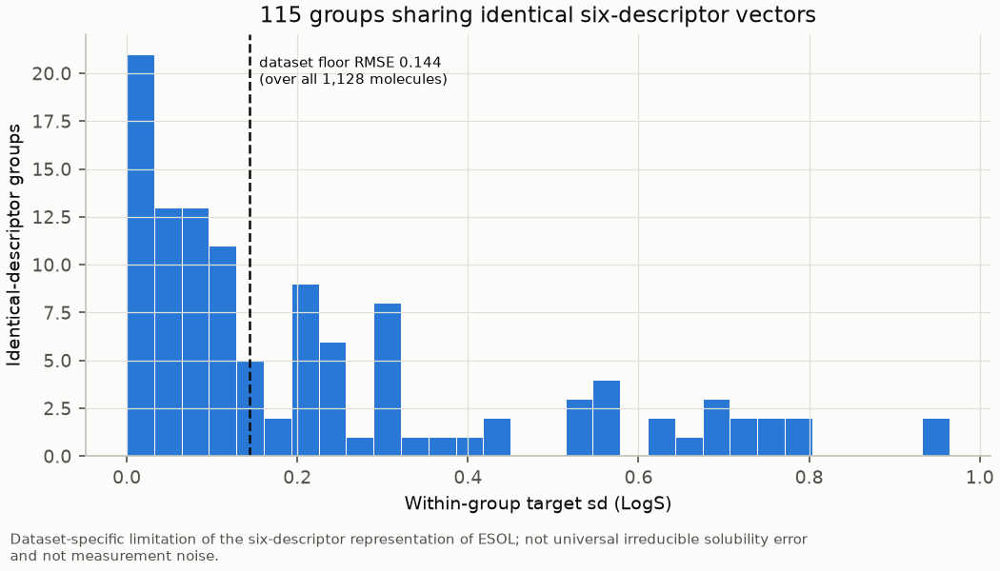
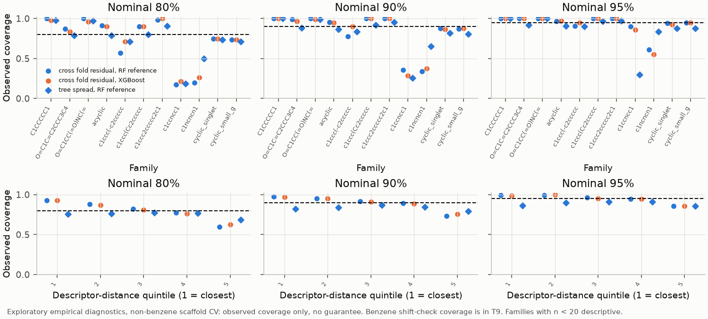

# Phase 6E Report — Scientific Interpretation and Model Diagnostics

**Run:** `20261027T190303Z_e5e48d78` · **Configuration:** `configs/phase6e.json` (MD5 `e5e48d78…`, unchanged from the committed version) · **Plan:** `docs/PHASE6E_PLAN.md` · **Inputs:** Phase 6D run `20261027T154454Z_d02c301c` (read-only)

Phase 6E is **diagnostic and descriptive**. It changes no model ranking and does not revise the Phase 6D conclusions. The primary Phase 6D result still reads: *the production-configuration Random Forest and XGBoost are practically equivalent at δ = 0.05 LogS on unseen non-benzene scaffolds, conditional on δ and on the validity of the scaffold-cluster bootstrap.*

How to read this report:
- **Observations** are measured from the out-of-fold diagnostics.
- **Hypotheses** are possible chemical explanations, each paired with the diagnostic that could contradict it.
- **Protocols are never pooled.** Non-benzene scaffold CV (874 molecules) uses scaffold-cluster bootstrap intervals. The benzene holdout (254 molecules) uses molecule-bootstrap intervals, which are conditional and descriptive.

## 1. Execution and integrity

| Check | Result |
|---|---|
| Refit check: predictions vs Phase 6D (tolerance 10⁻⁹) | Pass for RF reference, RF tuned, XGBoost and Lasso in all 26 folds; maximum difference 1.8 × 10⁻¹⁵ |
| Fold assignments vs Phase 6D | Identical |
| Recomputed neighbour statistics vs Phase 6D | Maximum difference 2.9 × 10⁻¹⁵ |
| Production RF, Phase 3 test RMSE | 0.8349452807, reproduced exactly; an in-memory refit of the production configuration matches its predictions |
| TreeSHAP additivity (tolerance 10⁻⁴) | Pass |
| Representation floor vs configuration | 0.14399468, 115 groups, 304 rows (exact) |
| Protected files (52) | Byte-identical before and after both runs |
| Benchmark / full run | Estimate 5.4 min; actual run 101 s (8 cores) |
| Reproducibility | A second full run (105 s) gave byte-identical tables, large outputs and all 19 PNG figures |
| Tests | 140 backend (114 existing + 26 new) and 12 frontend tests pass |

## 2. Observed vs predicted and calibration


| Protocol | Model | Calibration slope [95% CI] | Intercept [95% CI] | Shrinkage slope [95% CI] | Residual excess kurtosis |
|---|---|---|---|---|---|
| Non-benzene CV | RF reference | 1.014 [0.973, 1.050] | 0.02 [−0.16, 0.18] | −0.145 [−0.183, −0.113] | 3.29 |
| Non-benzene CV | XGBoost | 1.016 [0.978, 1.051] | 0.02 [−0.15, 0.17] | −0.143 [−0.184, −0.111] | 2.89 |
| Non-benzene CV | Lasso | 0.993 [0.935, 1.045] | −0.11 [−0.31, 0.10] | −0.214 [−0.280, −0.162] | 0.94 |
| Benzene holdout | RF reference | 0.825 [0.757, 0.897] | −0.48 [−0.68, −0.28] | −0.102 [−0.172, −0.024] | 0.12 |
| Benzene holdout | XGBoost | 0.865 [0.799, 0.930] | −0.34 [−0.53, −0.14] | −0.126 [−0.183, −0.066] | −0.24 |
| Benzene holdout | Lasso | 1.043 [0.942, 1.150] | 0.42 [0.10, 0.75] | −0.364 [−0.425, −0.303] | −0.29 |

**Observations**
- **Non-benzene CV is calibrated on average.** Slopes are about 1 and intercepts about 0 (F2).
- **Shrinkage is present in every model.** Residuals fall as the observed value rises (F4, right): extreme values are pulled towards the mean. This is distinct from miscalibration.
- **The tree residuals are heavy-tailed** (excess kurtosis about 3).
- **Benzene holdout:** the tree models' calibration slopes are below 1, meaning their predictions are more spread out than the observations. Lasso has a positive offset. These intervals are conditional on one training set.



**Extreme errors (T2).** 33 molecules meet the rule (top 25 RF-reference |residual| plus any |residual| > 2). They are flagged, not corrected. The largest:

| Compound | Family | Observed | RF ref | XGBoost |
|---|---|---|---|---|
| decachlorobiphenyl | biphenyl | −11.60 | −7.37 | −7.43 |
| vamidothion | acyclic | 1.14 | −2.96 | −3.02 |
| Dimecron | acyclic | 0.52 | −3.40 | −3.19 |
| bromadiolone | cyclic singleton | −4.45 | −8.11 | −7.34 |
| triethyl phosphate | acyclic | 0.43 | −2.75 | −2.31 |
| simazine | triazine | −4.55 | −1.53 | −1.60 |

Several of the worst under-predictions of solubility are acyclic organophosphorus esters (vamidothion, Dimecron, triethyl phosphate, trichlorfon, Azodrin).

**Hypothesis (not tested in Phase 6E):** RDKit's `Descriptors.TPSA` excludes phosphorus and sulfur contributions by default, so the polarity of these esters may be under-represented. *Contradicting diagnostic for a future phase:* recompute TPSA including S and P and check whether these residuals shrink.

## 3. Feature importance


Importance is the pooled RMSE increase computed from prediction-level squared errors (each molecule's error averaged over repeats); fold variability is reported separately in T3.

| Non-benzene CV | LogP | MolWt | TPSA | RotBonds | HBA | HBD | Polarity group | Size group | MolWt + LogP |
|---|---|---|---|---|---|---|---|---|---|
| RF permutation | **1.97** [1.82, 2.11] | 0.35 | 0.08 | 0.02 | 0.01 | 0.01 | 0.12 | 0.34 | 2.12 |
| XGBoost permutation | **2.02** [1.87, 2.17] | 0.26 | 0.21 | 0.01 | 0.02 | 0.00 | 0.21 | 0.25 | 2.14 |
| RF drop-column | **0.36** [0.27, 0.45] | 0.04 | 0.00 | 0.02 | 0.00 | 0.00 | 0.03 | 0.06 | **1.21** |
| XGBoost drop-column | **0.34** [0.28, 0.40] | 0.04 | 0.01 | 0.00 | −0.01 | 0.00 | 0.03 | 0.04 | **1.16** |

**Observations**
- **LogP ranks first in every fold** (rank-first fraction 1.0) and under every method: permutation, drop-column, impurity, total gain and mean |TreeSHAP| (F9).
- **The descriptors are largely interchangeable.** Permuting LogP raises RMSE by about 2.0 LogS, but dropping it and refitting raises it by only about 0.35. The models recover most of the LogP information from MolWt and the polarity descriptors. Dropping MolWt and LogP *together* costs about 1.2 LogS.
- **HBD and HBA contribute almost nothing on their own.** Lasso nevertheless gives HBA a positive coefficient (+0.35) while TPSA is negative (−0.48), and the ALE direction for HBD differs between the trees and Lasso. These sign differences are consistent with collinearity (TPSA–HBA r = 0.90) and **should not be read chemically**.
- **XGBoost relies more on TPSA than the Random Forest does** (0.21 vs 0.08).
- **The deployed production model** (Phase 3 random split, T10/F19) shows the same pattern: permutation LogP 2.01, MolWt 0.29; drop-column LogP 0.25, MolWt + LogP 1.03. This is not evidence of scaffold generalization.



**ALE (F10).** LogP, MolWt and TPSA show monotonic decreasing effects in every model.
- Gray shading marks sparse regions outside the 5th–95th percentile: MolWt < 74 or > 391, LogP < −0.31 or > 5.74, TPSA > 100, HBD > 2, HBA > 6, RotBonds > 7. The tree curves are flat there and the Lasso curves continue linearly, so **none of these regions supports an interpretation**.
- The integer-descriptor curves (HBD, HBA, RotBonds) rest on very few molecules beyond their first few values.

## 4. Chemical interpretation of the descriptors (T4)

| Descriptor | RDKit function | Observed behaviour in the models | Background expectation (context, not a finding) |
|---|---|---|---|
| LogP | `Descriptors.MolLogP` (calculated by Crippen's method) | Dominant; monotonic decrease | Higher lipophilicity tends to lower aqueous solubility |
| MolWt | `Descriptors.MolWt` | Second; decreasing, largely substitutable by LogP | Larger molecules tend to be less soluble |
| TPSA | `Descriptors.TPSA` (N and O only by default) | Third; decreasing in this data, which is counter to the naive expectation and possibly confounded by size | More polar surface tends to raise solubility, other things equal |
| HBD, HBA | `Descriptors.NumHDonors` / `Descriptors.NumHAcceptors` | Near-zero importance; sign unstable | Ambiguous: water interaction vs crystal-lattice strength |
| RotBonds | `Descriptors.NumRotatableBonds` | Small | Flexibility may weaken crystal packing in some series |

**Not representable with these six descriptors:**
- crystal-lattice energy or melting point;
- ionization and pH;
- stereochemistry and molecular symmetry;
- substitution pattern (positional isomers collide).

## 5. Scaffold families


Mean signed error is predicted − observed. Benzene comes from its holdout; all other families from non-benzene CV. Triazines and pyridines are **descriptive only (n < 20)**.

| Family (n) | RF ref | XGBoost | Lasso | ESOL eq. (in-sample) | Shared sign |
|---|---|---|---|---|---|
| Benzene (254) | −0.02 | −0.06 | −0.28 | −0.35 | all negative |
| Biphenyl (39) | +0.21 | +0.12 | +0.36 | +0.63 | all positive |
| 1,3,5-Triazine (16) | **+1.53** | **+1.52** | **+1.38** | +0.29 | all positive |
| Pyridine (14) | **−1.17** | **−1.07** | **−1.55** | **−1.81** | all negative |
| Acyclic (317) | −0.10 | −0.11 | −0.15 | −0.02 | all negative |

### 1,3,5-Triazines (n = 16, descriptive)

**Observations**
- Every ML model, trees and linear alike, over-predicts solubility by about 1.4–1.5 LogS. 15 of the 16 are amino-s-triazine herbicides (e.g. atrazine, simazine, prometryn); altretamine is the exception.
- The in-sample ESOL equation's bias is much smaller (+0.29). That equation was fitted on data that included these molecules, so this is not independent evidence.
- No triazine descriptor is out of range. However, 39% of predictions fall below the minimum target of their 10 nearest training neighbours, and the nearest structural neighbours are dissimilar (Tanimoto 0.20–0.33).
- The residuals barely vary with LogP (Spearman −0.08 to 0.16).

**Hypothesis:** a crystal-lattice or melting-point contribution (symmetric, H-bonded heteroaromatics) is missing from the descriptors.

**Status:** not contradicted. The bias is shared across model classes, is not explained by out-of-range descriptors, and does not vary with LogP. It also **cannot be tested here**, because ESOL has no melting points.

### Pyridines (n = 14, descriptive)

**Observations**
- Every model under-predicts by about 1.1–1.6 LogS, and so does the in-sample ESOL equation (−1.81).
- Five dimethylpyridines share identical descriptors and so receive identical predictions (about −1.15 against observed values of about +0.4).
- 79% of the nearest training neighbours contain no aromatic nitrogen; they are mostly xylenes and benzenes.
- Lasso residuals rise with HBA (Spearman 0.69) and TPSA (0.66).

**Hypothesis:** the basic, H-bond-accepting ring nitrogen is more solubilizing than the descriptors capture.

**Status:** not contradicted (shared bias; carbocyclic neighbours). With n = 14, and with most observed values lying near the top of the LogS range, this remains a lead to investigate further, not an established effect.

### Biphenyls (n = 39; one scaffold, molecule bootstrap, descriptive)

**Observations**
- 4 of the 39 members (10%) carry an extrapolation indicator: target below the training-fold or 10-nearest-neighbour minimum, or LogP above the training maximum. The most extreme is decachlorobiphenyl (LogS −11.6, LogP 9.9).
- For those 4: RMSE is 2.50 (RF) and 2.39 (XGBoost) vs **0.40 (Lasso)**.
- For the other 35: RMSE is 0.94 (RF), 0.72 (XGBoost) and 0.70 (Lasso).
- Tree residuals rise with LogP (Spearman +0.69 RF, +0.57 XGBoost); Lasso's do not (−0.39).


**Hypothesis:** tree models cannot predict beyond the training targets in their neighbourhood, while a linear model extrapolates in LogP.

**Status:** consistent with the diagnostics. The Lasso advantage over XGBoost largely disappears among non-extrapolating members (0.70 vs 0.72). The RF reference stays worse there (0.94), which extrapolation alone does not explain.

## 6. Acyclic molecules and structural similarity



**Observations**
- **Acyclic test molecules have much closer training neighbours than cyclic ones.** Median maximum Tanimoto similarity is 0.54 vs 0.45, and **12.3% have a training neighbour with an identical fingerprint** (Tanimoto = 1.0), compared with 2.2% of cyclic molecules.
- **There are 39 fingerprint collisions.** Most are homologous pairs that Morgan radius-2 fingerprints cannot tell apart (1-hexanol/1-heptanol, 1-octene/1-decene, methyl octanoate/methyl decanoate). Their targets can still differ by up to 1.5 LogS.
- **34% of acyclic molecules (109 of 317) have a CH₂ homologue as their nearest training neighbour.**
- **Acyclic RF RMSE falls with similarity:** 1.18 (< 0.4), 0.53, 0.44, 0.29 (0.8–1.0). Acyclic accuracy therefore reflects close analogues in training, not scaffold generalization.

## 7. Reliability vs distance in descriptor space


**Observations**
- **Non-benzene CV:** RF RMSE rises steadily by distance quintile: 0.51, 0.59, 0.78, 0.86, 1.25.
  - Keeping only the closest 10% of molecules gives RMSE 0.47, against 0.84 for all.
  - Spearman correlation of distance with |error|: 0.36 (RF), 0.31 (XGBoost), −0.09 (Lasso).
- **The range flag** (any descriptor outside the training-fold range) affects only 15 molecules (40 predictions). Their RMSE is 1.15 against 0.83 for the rest (RF); for Lasso it is 1.99 against 1.04.
- **Benzene holdout:** the pattern is weaker (0.72 → 0.98 for RF; Spearman 0.26), and no benzene molecule is out of range.
- **Interpretation:** distance usefully ranks reliability for the tree models but not for Lasso. A training-range check flags very few molecules.

## 8. Representation floor



**Definition.** 304 molecules (115 groups) share an identical six-descriptor vector with at least one other molecule. Their within-group target variance implies a **floor RMSE of 0.144 LogS**: the lowest RMSE any function of these six descriptors could reach on ESOL.

**Scope.** This is a **dataset-specific limitation of the six-descriptor representation**, not a universal irreducible error of aqueous solubility, and not measurement noise. The groups with the largest spread are genuinely different compounds:
- chrysene / naphthacene / triphenylene (sd 0.96);
- benzo[a]- / benzo[b]fluorene;
- theophylline / theobromine;
- 1,2,4- / 1,3,5-tribromobenzene;
- phenanthrene / anthracene.

Measurement noise was not estimated, because the identity duplicates are not independent replicates.

## 9. Interval diagnostics (exploratory; observed coverage only, no guarantee)



| Protocol | Method | 80% | 90% | 95% |
|---|---|---|---|---|
| Non-benzene CV | RF tree spread | 0.75 | 0.83 | 0.89 |
| Non-benzene CV | Cross-fold residual, RF | 0.80 | 0.89 | 0.95 |
| Non-benzene CV | Cross-fold residual, XGBoost | 0.80 | 0.90 | 0.95 |
| Benzene holdout | RF tree spread | 0.75 | 0.85 | 0.91 |
| Benzene holdout | Shift check (calibrated on non-benzene), RF | 0.76 | 0.90 | 0.97 |
| Production RF (Phase 3 split) | Tree spread | 0.70 | 0.82 | 0.88 |

**Observations**
- **Overall:** RF tree spread under-covers everywhere; its correlation with |error| is 0.39 for non-benzene CV and 0.13 for the benzene holdout. Cross-fold residual intervals come close to nominal *overall*.
- **Coverage fails badly where bias is systematic.** At nominal 90%, observed coverage is 0.34–0.38 for triazines and 0.29–0.36 for pyridines (n < 20, descriptive). It also falls in the farthest distance quintile (about 0.73–0.79).
- **Assumptions:** exchangeable scaffold groups (not established), dependence within scaffolds, and residuals pooled from different fold models. A formally justified conformal procedure was not implemented.

## 10. Limitations of interpreting models trained on ESOL

1. **The data:** 1,128 compounds from heterogeneous literature sources, with unrecorded temperature, pH and polymorph; no per-measurement uncertainty; dominated by pesticides and environmental chemicals; duplicate entries; missing stereochemistry.
2. **The features:** six 2D calculated descriptors. LogP is itself a calculated estimate whose errors propagate into the model. Melting point and ionization are not represented.
3. **The methods:** importance, TreeSHAP and ALE describe *these models on ESOL*. They are not chemical mechanisms. Correlated descriptors divide credit arbitrarily, and permutation creates unrealistic descriptor combinations.
4. **Family results:** families under 20 molecules (triazine, pyridine) are descriptive. Named-family intervals use a molecule bootstrap that ignores dependence within the family. The ESOL-equation comparison is in-sample.
5. **Generalization:** acyclic performance reflects close analogues in training. Unseen scaffolds are not necessarily far away in descriptor space. The benzene-holdout statistics are conditional on one training set.
6. **External validity:** nothing in Phases 6A–6E has been validated on a dataset other than ESOL. The deployed predictor should be treated as unreliable outside ESOL's chemical space, especially for triazine-like and pyridine-like chemotypes, highly chlorinated aromatics, and molecules far from the training data in descriptor space.

## 11. Deviations from the approved plan

There were no changes to the methodology or the configuration. Implementation clarifications and fixes:

- **Determinism fix.** The deployed model is saved with `n_jobs=-1`, and its threaded tree averaging changed the last floating-point bit between runs (differences of about 10⁻¹⁶ in T10). The in-memory copy is set to `n_jobs=1` before predicting. The file is never written, the RMSE check is unaffected, and both runs are byte-identical after the fix.
- **ALE across folds.** Fold curves are interpolated onto a common grid (the same edge rule applied to all S0 values), with no extrapolation beyond each fold's edges. "Sparse region" in F10 is shaded as outside the 5th–95th percentile.
- **Repeat aggregation.**
  - The nearest neighbour reported for a molecule is the one most frequent across repeats (ties to the lowest `row_id`).
  - Extrapolation indicators are fractions of repeats; family-level "any indicator" means in any repeat.
  - The range-flag comparison is at prediction level (per molecule and repeat).
- **Reported points for importance.** Pooled importance is the mean over permutations of the pooled RMSE increase. The bootstrap interval is centred on the RMSE difference computed from permutation-averaged squared errors; the two are reported side by side.
- **Superseded run directories.** Two of my own run directories produced before the footnote-layout and determinism fixes were deleted.
- **Stalled run.** One reproducibility run stalled for about 90 minutes before its worker processes started, most likely because the machine slept. It was stopped, and the rerun completed normally in 105 s.

## 12. Outputs

| Location | Contents |
|---|---|
| `docs/images/phase6e/` (tracked; 2.9 MB) | F01–F19 |
| `reports/phase6e/` (tracked JSON) | T1–T10, `summary.json`, `benchmark.json`, `feasibility_estimate.json` |
| `results/phase6e/<run_id>/` (Git ignored) | Importance arrays, TreeSHAP values, neighbour records, refit predictions with tree spread, interval coverage, config snapshot, `pip freeze` |

**Reproduce**
```bash
python src/model_diagnostics.py --benchmark
python src/model_diagnostics.py
```
